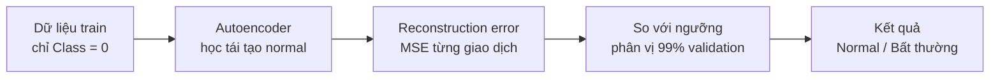
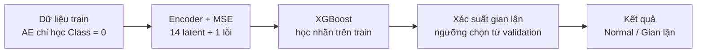

# 💳 Phát hiện giao dịch gian lận thẻ tín dụng bằng Autoencoder

> **Seminar Khai phá dữ liệu (Data Mining)** — So sánh *Autoencoder độc lập* (phát hiện bất thường) và *Autoencoder + XGBoost* (kết hợp có giám sát) trên bộ dữ liệu giao dịch thẻ tín dụng bị unbalanced.


---

## 📑 Mục lục

1. [Giới thiệu](#-giới-thiệu)
2. [Bộ dữ liệu](#-bộ-dữ-liệu)
3. [Hai phương pháp được so sánh](#-hai-phương-pháp-được-so-sánh)
4. [Quy trình thực nghiệm](#-quy-trình-thực-nghiệm)
5. [Kết quả](#-kết-quả)
6. [Cách chạy lại](#-cách-chạy-lại)
7. [Cấu trúc thư mục](#-cấu-trúc-thư-mục)
8. [Hạn chế](#-hạn-chế)
9. [Tài liệu tham khảo](#-tài-liệu-tham-khảo)

---

## 🎯 Giới thiệu

Gian lận thẻ tín dụng là bài toán điển hình của **dữ liệu mất cân bằng**: giao dịch gian lận chỉ chiếm chưa đến 0,2% tổng số giao dịch. Với dữ liệu như vậy, một mô hình ngây thơ luôn đoán "bình thường" vẫn đạt accuracy > 99,8% nhưng hoàn toàn vô dụng.

Dự án này trả lời câu hỏi:

> Khi gian lận quá hiếm, nên **chỉ học hành vi bình thường rồi phát hiện điểm lạ**, hay **tận dụng thêm nhãn gian lận để học có giám sát**?

**Mục tiêu**

- Xây dựng Autoencoder học cách tái tạo giao dịch bình thường (`Class = 0`).
- Dùng **sai số tái tạo (reconstruction error)** để phát hiện giao dịch bất thường.
- Kết hợp **đặc trưng ẩn (latent features)** và sai số tái tạo của Autoencoder với **XGBoost**.
- So sánh hai phương pháp trên **cùng một tập kiểm tra**, bằng các chỉ số phù hợp với dữ liệu mất cân bằng (Precision, Recall, F1, PR-AUC), không dựa vào accuracy.

---

## 📊 Bộ dữ liệu

Nguồn: [Credit Card Fraud Detection — Kaggle](https://www.kaggle.com/datasets/mlg-ulb/creditcardfraud) (ULB Machine Learning Group).

| Thuộc tính | Giá trị |
|---|---|
| Số giao dịch | **284.807** |
| Số cột | 31 (`Time`, `V1`–`V28`, `Amount`, `Class`) |
| Giao dịch bình thường (`Class = 0`) | 284.315 — **99,8273%** |
| Giao dịch gian lận (`Class = 1`) | 492 — **0,1727%** |
| Giá trị thiếu | Không có |
| Dòng trùng hoàn toàn | 1.081 (giữ nguyên, không loại bỏ) |

**Ý nghĩa các cột**

- `V1`–`V28`: các thành phần chính thu được từ PCA (đã ẩn danh vì lý do bảo mật).
- `Amount`: số tiền giao dịch.
- `Time`: số giây kể từ giao dịch đầu tiên — **bị loại khỏi cả hai mô hình** trong thí nghiệm này.
- `Class`: nhãn (`0` = bình thường, `1` = gian lận).


---

## 🧠 Hai phương pháp được so sánh

### Phương pháp A — Autoencoder phát hiện bất thường (không dùng nhãn gian lận)

Autoencoder chỉ được huấn luyện trên giao dịch **bình thường**. Nó học cách nén rồi tái tạo những mẫu "quen thuộc". Giao dịch gian lận khác với hành vi bình thường nên **khó tái tạo hơn → sai số cao hơn**. Giao dịch nào có sai số vượt ngưỡng sẽ bị gắn cờ.

- Ngưỡng = **phân vị 99%** của reconstruction error trên tập validation gồm toàn giao dịch bình thường (không dùng nhãn test, không dùng nhãn gian lận).



### Phương pháp B — Autoencoder + XGBoost (có giám sát)

Dùng Autoencoder đã huấn luyện ở trên (vẫn chỉ học từ giao dịch bình thường) để tạo **15 đặc trưng mới** cho mỗi giao dịch:

- **14 latent features** từ lớp nén (bottleneck) của encoder.
- **1 reconstruction error**.

Sau đó **XGBoost** học từ 15 đặc trưng này cùng nhãn `Class` trên tập train để phân loại gian lận.

- Xử lý mất cân bằng bằng `scale_pos_weight = số mẫu normal / số mẫu fraud` (≈ 577,65).
- Ngưỡng xác suất được chọn bằng cách **tối đa hóa F1 trên tập validation tách từ train** (không đụng đến tập test).



> 📝 Phương pháp B **dùng nhãn gian lận** khi huấn luyện XGBoost nên không còn là phát hiện bất thường thuần túy — đây là điểm khác biệt cốt lõi cần lưu ý khi so sánh.

### Kiến trúc Autoencoder

Mạng đơn giản, chỉ 855 tham số:

| Lớp | Kích thước | Kích hoạt | Vai trò |
|---|---|---|---|
| `input_features` | 29 | — | V1–V28 + Amount (đã chuẩn hóa) |
| `latent_space` | 14 | ReLU | Encoder — nén thông tin (bottleneck) |
| `reconstruction` | 29 | **Linear** | Decoder — tái tạo lại đầu vào |

- Loss: **MSE** | Optimizer: **Adam** (lr = 1e-3).
- Dùng **linear** ở đầu ra (không dùng sigmoid) vì dữ liệu đã qua `StandardScaler`, có thể âm hoặc lớn hơn 1.
- `EarlyStopping` (patience = 5, khôi phục trọng số tốt nhất), tối đa 50 epoch, batch size 256.

---

## 🔬 Quy trình thực nghiệm

1. **Nạp & khám phá dữ liệu (EDA):** kiểm tra kiểu dữ liệu, giá trị thiếu, dòng trùng, phân bố nhãn.
2. **Chia dữ liệu 80/20** có `stratify` để giữ tỷ lệ gian lận ở cả train và test:
   - Train: 227.845 giao dịch (394 gian lận) | Test: 56.962 giao dịch (**98 gian lận**).
3. **Chuẩn hóa:** `StandardScaler` chỉ `fit` trên giao dịch bình thường của tập train.
4. **Huấn luyện Autoencoder** trên giao dịch bình thường (90% để fit, 10% làm validation).
5. **Phương pháp A:** chọn ngưỡng từ validation bình thường → dự đoán trên test.
6. **Phương pháp B:** trích latent + lỗi tái tạo → huấn luyện XGBoost → chọn ngưỡng F1 trên validation → dự đoán trên test.
7. **So sánh** hai phương pháp trên cùng tập test.

**Các biện pháp tránh rò rỉ dữ liệu (data leakage)**

- Scaler chỉ học từ giao dịch bình thường của tập train.
- Autoencoder chỉ học từ giao dịch bình thường của tập train.
- Cả hai ngưỡng đều được chọn trên validation, **không bao giờ dùng tập test** để chọn ngưỡng hay tinh chỉnh.


---

## 📈 Kết quả

Đánh giá trên **tập test (56.962 giao dịch, trong đó 98 gian lận)**. Các chỉ số ở lớp **Fraud** (lần chạy khớp với hình bên dưới):

| Mô hình | Precision | Recall | F1 | PR-AUC (AP) |
|---|---:|---:|---:|---:|
| **A** — Autoencoder + ngưỡng | ≈ 0,11 | ≈ 0,75 | ≈ 0,19 | 0,264 |
| **B** — Autoencoder + XGBoost | **≈ 0,87** | ≈ 0,72 | **≈ 0,79** | **0,815** |

> Precision, Recall và F1 được đọc từ biểu đồ so sánh nên làm tròn khoảng 2 chữ số; PR-AUC lấy trực tiếp từ chú thích của đường Precision–Recall. Con số chính xác nằm trong output của notebook (cell *So sánh kết quả thực nghiệm*).

### Nhận xét

- **Recall của hai mô hình cùng mức (~0,72–0,75)**: cả hai đều bắt được khoảng 3/4 số vụ gian lận; A nhỉnh hơn B một chút.
- **Khác biệt lớn nằm ở Precision.** Với A, chỉ khoảng 1/9 cảnh báo là gian lận thật, tức khoảng 8–9 cảnh báo giả cho mỗi vụ gian lận được phát hiện; với B, gần như mỗi cảnh báo đều đúng. Trong thực tế, quá nhiều cảnh báo giả sẽ làm quá tải bộ phận kiểm duyệt và gây phiền cho khách hàng.
- **Accuracy không nói lên điều gì.** A vẫn đạt accuracy ~99% dù Precision chỉ ~11%, đây là lý do bài dùng Precision/Recall/F1/PR-AUC thay cho accuracy.
- **PR-AUC chênh rất xa (0,264 so với 0,815)**: khi xét trên toàn bộ các ngưỡng, B xếp hạng giao dịch gian lận tốt hơn hẳn A, nên lợi thế của B không phụ thuộc vào việc chọn đúng một ngưỡng cụ thể.
- A không cần nhãn gian lận khi huấn luyện, nên phù hợp khi chưa có hoặc có rất ít nhãn gian lận, hoặc muốn bắt cả kiểu gian lận hoàn toàn mới. B cho kết quả tốt hơn rõ rệt **khi đã có nhãn**, đổi lại phụ thuộc vào nhãn và có thể kém nhạy với kiểu gian lận chưa từng thấy.

### Độ dao động giữa các lần chạy

Hai lần chạy cùng một notebook (cùng `SEED = 42`, khác phiên chạy) cho kết quả không hoàn toàn giống nhau:

| Chỉ số | Lần chạy 1 | Lần chạy 2 |
|---|---:|---:|
| A — Recall | 0,8163 | ≈ 0,75 |
| A — PR-AUC | 0,2671 | 0,264 |
| B — Precision | 0,8351 | ≈ 0,87 |
| B — Recall | 0,8265 | ≈ 0,72 |
| B — F1 | 0,8308 | ≈ 0,79 |
| B — PR-AUC | 0,8311 | 0,815 |

Chỉ số bị ảnh hưởng nhiều nhất là **Recall**: do tập test chỉ có 98 vụ gian lận, mỗi vụ bắt được hay bỏ sót đã làm Recall đổi khoảng 1 điểm phần trăm. Tuy nhiên **kết luận định tính không đổi qua cả hai lần chạy**: B có Precision và PR-AUC vượt trội A, còn Recall của hai mô hình ở cùng mức.

> ℹ️ Nguyên nhân dao động: TensorFlow chạy đa luồng nên vẫn có sai khác nhỏ dù đã đặt seed, cộng với việc ngưỡng của cả hai phương pháp được chọn từ validation nên nhạy với thay đổi nhỏ của mô hình.

---

## 🚀 Cách chạy lại

### 1. Clone repo


### 2. Tạo môi trường và cài thư viện

```bash
python -m venv .venv

# Windows
.venv\Scripts\activate
# macOS / Linux
source .venv/bin/activate

pip install -r requirements.txt
```

### 3. Tải dữ liệu

Tải `creditcard.csv` từ [Kaggle](https://www.kaggle.com/datasets/mlg-ulb/creditcardfraud) và đặt **cùng thư mục với notebook** (file tên `creditcard.csv`).

Hoặc dùng Kaggle CLI:

```bash
kaggle datasets download -d mlg-ulb/creditcardfraud --unzip
```

> Nếu đặt file ở nơi khác, hãy sửa biến `DATA_PATH` trong cell nạp dữ liệu của notebook.

### 4. Chạy notebook

```bash
jupyter notebook CreditCardFraud_Autoencoder_Seminar_commented.ipynb
```

Chọn **Kernel → Restart & Run All**. Quá trình huấn luyện nhanh (mỗi epoch của Autoencoder chỉ khoảng 1 giây trên CPU). Các hình ảnh sơ đồ và so sánh sẽ được tự động lưu ra thư mục hiện tại.

---

## 📁 Cấu trúc thư mục

```text
.
├── notebook/
│   ├── CreditCardFraud_Autoencoder_Seminar_commented.ipynb
│   ├── so_do_autoencoder.png
│   ├── so_do_autoencoder_xgboost.png
│   └── so_sanh_hai_phuong_phap.png
├── data/
│   └── dataset_link.txt
├── README.md
├── requirements.txt
└── .gitignore
```
---

## ⚠️ Hạn chế

- **Tập test chỉ có 98 giao dịch gian lận**, nên mỗi vụ phát hiện thêm hoặc bỏ sót làm chỉ số thay đổi đáng kể (ví dụ Recall chênh ~1% tương đương đúng 1 giao dịch). Thí nghiệm chỉ dùng **một lần chia dữ liệu và một seed**; chưa có cross-validation hay lặp nhiều lần để đo độ dao động. Hai lần chạy thực tế đã cho Recall của B lệch nhau khoảng 10 điểm phần trăm (xem [Độ dao động giữa các lần chạy](#độ-dao-động-giữa-các-lần-chạy)).
- Autoencoder **rất nông** (1 lớp ẩn, 14 chiều); chưa thử kiến trúc sâu hơn, Variational Autoencoder hay tinh chỉnh siêu tham số.
- Ngưỡng 99% của phương pháp A là **quy tắc vận hành có thể điều chỉnh**, không phải ngưỡng tối ưu. Trong thực tế, ngưỡng phụ thuộc vào chi phí của cảnh báo giả so với chi phí bỏ sót gian lận.
- Đặc trưng `Time` bị loại bỏ và 1.081 dòng trùng được giữ nguyên — đây là lựa chọn thực nghiệm, không phải quy tắc bắt buộc.
- Dữ liệu là giao dịch **đã ẩn danh bằng PCA**, thu thập trong khoảng 2 ngày; đây là thử nghiệm học thuật, **không chứng minh mô hình hoạt động tương tự trên hệ thống ngân hàng thực tế**.

---

## 📚 Tài liệu tham khảo

- Dataset: [Credit Card Fraud Detection — Kaggle (mlg-ulb)](https://www.kaggle.com/datasets/mlg-ulb/creditcardfraud), do Worldline và ULB Machine Learning Group thu thập.
- Dal Pozzolo, A., Caelen, O., Johnson, R. A., Bontempi, G. (2015). *Calibrating Probability with Undersampling for Unbalanced Classification.* IEEE Symposium Series on Computational Intelligence.
- [TensorFlow / Keras](https://www.tensorflow.org/) · [XGBoost](https://xgboost.readthedocs.io/) · [scikit-learn](https://scikit-learn.org/)

---

<p align="center"><i>Bài seminar môn Khai phá dữ liệu — © <b>Nguyễn Phúc An Khang</b></i></p>
